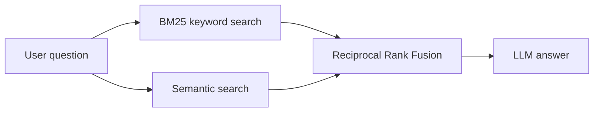

<div align="center">

<a href="https://git.io/typing-svg">
  
</a>

<br/>


</div>

---

## About me

```python
class Sayan:
    name       = "Sayan Mete"
    studying   = "B.Tech CSE (final year), Swami Vivekananda University"
    focus      = ["LLM applications", "Agentic RAG", "Deep learning"]
    learning   = "LangGraph: conditional edges, tools, checkpointing"
    side_quest = "Bilingual (English + Bengali) study material and MCQ decks"

    def goal(self):
        return "Ship reliable GenAI products"
```

---

## Tech stack

<div align="center">


<br/><br/>


</div>

| Area | Tools |
|---|---|
| GenAI | LangGraph, LangChain (LCEL), RAG, hybrid search, Groq, Hugging Face |
| ML / DL | PyTorch, LSTM, CNN, Transformers, NLP fundamentals |
| Backend and apps | FastAPI, Streamlit |
| Vision | OpenCV |
| Workflow | Git, VS Code, uv, Jupyter |

---

## Featured projects

<table>
  <tr>
    <td width="50%" valign="top">
      <h3>RAG Assistant</h3>
      <p>Multi-agent retrieval-augmented generation. Hybrid search combines BM25 and semantic search with Reciprocal Rank Fusion.</p>
      <p><b>Stack:</b> LangGraph, LangChain, Groq (Llama 3.3 70B), Hugging Face embeddings, Streamlit</p>
    </td>
    <td width="50%" valign="top">
      <h3>LangGraph Chat</h3>
      <p>A chat app with a LangGraph workflow behind a FastAPI endpoint and a dark-themed HTML frontend.</p>
      <p><b>Stack:</b> LangGraph, FastAPI, HTML/JS</p>
    </td>
  </tr>
  <tr>
    <td width="50%" valign="top">
      <h3>Real-time Emotion Detection</h3>
      <p>A CNN that reads facial emotions from a live webcam feed.</p>
      <p><b>Stack:</b> PyTorch, OpenCV, FER-2013</p>
    </td>
    <td width="50%" valign="top">
      <h3>Sentiment and Next-word Models</h3>
      <p>A 3-class sentiment classifier and a next-word predictor with a custom vocabulary.</p>
      <p><b>Stack:</b> PyTorch, LSTM</p>
    </td>
  </tr>
</table>

Repository links: *add them here*

### How the RAG assistant retrieves



---

## GitHub stats

<div align="center">


</div>

---

## Roadmap

<details>
<summary><b>Click to expand my GenAI learning path</b></summary>
<br/>

- [x] LangChain and RAG fundamentals
- [x] LangGraph core: state, nodes, edges, parallel workflows
- [ ] Conditional edges, tools, checkpointing, human-in-the-loop
- [ ] Agentic RAG with relevance grading and query rewriting
- [ ] Multi-agent supervisor workflow
- [ ] Evaluation with LangSmith and RAGAS
- [ ] Deployment with Docker and a Postgres checkpointer

</details>

---

## Connect with me

<div align="center">

[](https://linkedin.com/in/YOUR_LINKEDIN)
[](mailto:YOUR_EMAIL)
[](https://YOUR_PORTFOLIO)

</div>


